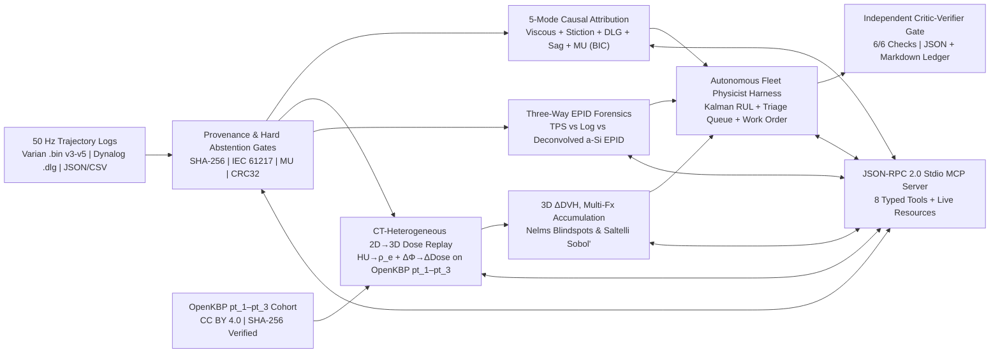
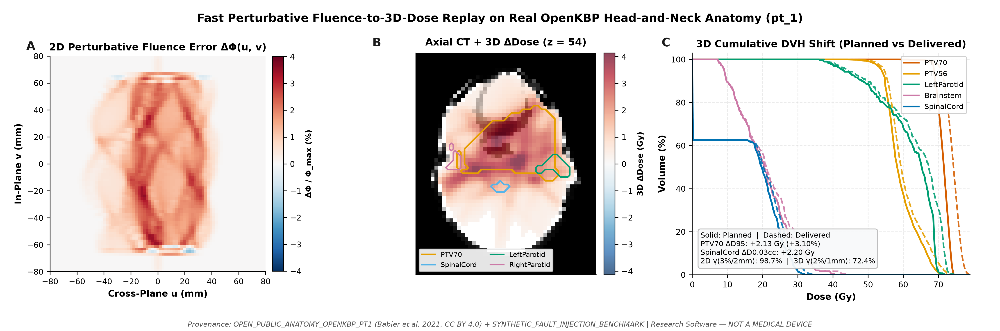
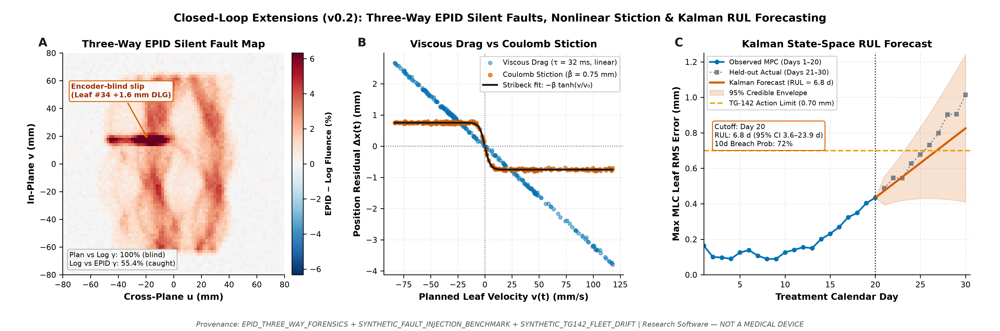

# linac-forensics

**Closed-Loop Linac Telemetry, Three-Way EPID & Heterogeneity-Aware Perturbative 3D Delivery-Forensics Engine with Frontier Agent Harness & MCP Server**

[](https://www.python.org/)
[](pyproject.toml)
[](LICENSE)
[](LICENSE)
[](docs/AUDIT_REPORT.md)
[](docs/AUDIT_REPORT.md)
[](pyproject.toml)

> **Research Software — NOT A MEDICAL DEVICE.**
> `linac-forensics` is open-source scientific research software for radiotherapy machine physics, AAPM TG-142 / TG-218 QA methodology research, and delivery-forensics benchmarking. It has **not** been cleared or approved by the FDA, EU MDR/CE, or any regulatory authority and must **never** be used for clinical patient QA sign-off, treatment decisions, or linear accelerator calibration.

---

## Why `linac-forensics`?

Consumer AI chat interfaces cannot parse 50 Hz binary Varian TrueBeam trajectory logs (`.bin`) or legacy Dynalogs (`.dlg`), deconvolve a-Si EPID portal images to catch encoder-blind silent faults, project sub-millimeter MLC aperture errors through CT electron-density heterogeneities into 3D patient OAR anatomy, or run Bayesian causal attribution and Kalman RUL forecasting across a treatment fleet. `linac-forensics` closes the loop across every layer:

- **Native Varian TrueBeam `.bin` (v3.0/v4.0/v5.0) + Legacy Dynalog `.dlg` + JSON/CSV** ingestion with 5 hard **`AbstentionError`** safety gates (`TIMESTAMP_DESYNC`, `MU_CONSERVATION_VIOLATION`, `UNMAPPED_IEC61217_COORDINATES`, `CORRUPTED_BINARY_LOG`, `INTERLOCK_INCOMPLETE_DELIVERY`).
- **CT-Heterogeneity-Aware Perturbative Fluence-to-3D-Dose Replay (`ΔΦ → ΔDose → ΔDVH / ΔgEUD / ΔTCP / ΔNTCP`)** across a SHA-256 verified **3-patient OpenKBP cohort (`pt_1`, `pt_2`, `pt_3`, CC BY 4.0)** using piecewise-linear HU-to-$\rho_e$ radiological depth & scatter scaling — exposing **Nelms et al. (2011) 2D 3%/2mm Gamma blindspots** while preserving exact zero-error identity (`actual == expected ⇒ ΔΦ ≡ 0, ΔDose ≡ 0, γ ≡ 100.0%`).
- **Three-Way Closed-Loop EPID Portal Dosimetry Forensics (`Planned TPS` vs. `Trajectory Log` vs. `Measured EPID`)**: catches **encoder-blind silent hardware faults** (slipped optical encoders, unrecorded DLG/jaw drift, or TG-142 beam-steering symmetry tilts) invisible to trajectory logs alone.
- **5-Mode Electro-Mechanical Causal Attribution (Matched-Filter + Bayesian BIC)** separating:
  1. Localized MLC leaf motor viscous drag ($\Delta x_i(t) \approx -\tau_i v_i(t)$)
  2. Nonlinear MLC Coulomb / Stribeck stiction & leadscrew backlash ($\Delta x_i(t) \approx -\beta_i \tanh(v_i / v_0)$)
  3. Systematic Bank / Dosimetric Leaf Gap (DLG) calibration offset ($\Delta\text{gap} = c$)
  4. Gantry gravity-sag harmonic ($\Delta y(\theta) = A\sin\theta + B\cos\theta$)
  5. Monitor ion-chamber / dose-rate calibration drift ($\Delta\text{MU}/\text{MU} = \delta$)
- **Kalman State-Space Remaining-Useful-Life (RUL) Forecasting & Multi-Fraction Cumulative 3D Dose Accumulation**: predicts TG-142 action-limit breaches with 95% credible envelopes, separates systematic vs. random fraction errors, and computes compensatory remaining-course adaptive MU scaling.
- **Exact Saltelli–Jansen QMC Global Sobol' Sensitivity**, **Autonomous Fleet Physicist Harness** (with 6-check Critic-Verifier Gate), and an **8-Tool + Resource-Enabled JSON-RPC 2.0 Stdio MCP Server**.

---

## System Architecture



---

## Verified Benchmark Dashboard (v0.2.0)

All metrics below are deterministically reproduced by `scripts/run_benchmarks.py` ([benchmark_summary.json](results/benchmark_summary.json)) on real **OpenKBP `pt_1`, `pt_2`, `pt_3`** anatomies paired with explicitly provenance-tagged synthetic fault benchmarks:

| Benchmark & Physics Invariant | Measured Result | Reference / Gate |
| --- | --- | --- |
| **Varian `.bin` v5.0 Round-Trip (360 × 120 leaves, CRC32)** | Write `2.7 ms`, Parse `3.7 ms`, Max error `5.72 × 10⁻⁶ mm` | IEEE-754 `float32` exact |
| **Zero-Error Identity Invariant (w/ CT HU→$\rho_e$ Heterogeneity)** | `max\|ΔΦ\| = 0.0`, `max\|ΔD\| = 0.0 Gy`, `γ = 100.0%` | Exact machine epsilon |
| **5-Mode Causal BIC Attribution (Viscous, Stiction, DLG, Sag, MU)** | **Exact classification**; Stiction `0.7015 / 0.70 mm`; Joint 4-fault `99.8%–100.0%` | 95% CIs cover ground truths |
| **Three-Way EPID Encoder-Blind Silent Fault Detection** | Plan-vs-Log `γ = 100.0%` (blind) → Log-vs-EPID **`γ = 55.4%`** (`max\|ΔΦ\| = 15.2%`) | Caught & classified |
| **Nelms 2D Gamma Blindspot Sweep (32 faulted deliveries)** | **17/17 (100%)** failing plans passed 2D `3%/2mm` (`≥95%`); **17/17 caught** by 3D `2%/1mm` & `ΔDVH` | AAPM TG-218 / Nelms 2011 |
| **Kalman State-Space RUL Forecast (Cutoff Day 20)** | Predicted breach in **`6.8 d`** (Day 26.8 vs actual **Day 26**; `72%` 10d breach prob) | `0.8 d` ahead-of-time error |
| **Multi-Fraction Accumulation (`OpenKBP pt_2`, 5/35 fx)** | Cumulative `PTV70 ΔD95 = -2.64%` (`sys = -2.64%`, `rand = 0.30%`); adaptive MU scale `1.0044` | Real 3D OpenKBP `pt_2` |
| **Global Sobol' Sensitivity (`N = 3,072` evals/metric)** | `PTV70 ΔD95`: MU (`0.47`), MLC Lag (`0.33`), DLG (`0.18`) · `SpinalCord ΔD0.03cc`: MU (`0.41`), Sag (`0.31`), DLG (`0.21`) | Saltelli 2010 QMC |

---

## Publication-Grade Figures (7 × 300-DPI PNG + PDF, Visually Audited)

### 1. High-Frequency (50 Hz) Trajectory Log Forensics


### 2. Heterogeneity-Aware Perturbative Fluence-to-3D-Dose Replay on OpenKBP `pt_1`


### 3. Nelms et al. (2011) 2D Gamma Blindspot vs True 3D `ΔDVH`


### 4. Bayesian BIC Causal Fault Attribution & Joint 4-Fault Recovery


### 5. 30-Day Multi-Linac TG-142/MPC Drift & Clinical Patient Triage Matrix


### 6. Global Saltelli–Jansen QMC Sobol' Sensitivity (`S₁` vs `S_T`)


### 7. Three-Way EPID Silent Faults, Nonlinear Coulomb Stiction & Kalman RUL Forecasting (v0.2)


---

## Quickstart

```bash
# 1. Install dependencies with uv (Python 3.12)
uv sync --python 3.12 --extra dev

# 2. Verify / fetch OpenKBP pt_1, pt_2, pt_3 anatomies (CC BY 4.0, SHA-256 verified)
uv run python scripts/fetch_openkbp_anatomy.py

# 3. Run full test suite (38 tests, 0 warnings, >= 75% coverage gate) & lint
uv run pytest --cov=linac_forensics --cov-report=term-missing
uv run ruff check src tests scripts

# 4. Reproduce all benchmarks and 7 publication-grade figures (300-DPI PNG + PDF)
uv run python scripts/run_benchmarks.py
uv run python scripts/generate_figures.py
```

---

<details>
<summary><strong>Python API Workflow (Binary/Dynalog Parse → 5-Mode Causal Attribution → EPID Three-Way → 3D DVH & Kalman RUL)</strong></summary>

```python
from pathlib import Path
from linac_forensics import (
    analyze_three_way_epid_forensics,
    compute_perturbative_dose_replay,
    diagnose_causal_faults,
    forecast_tg142_kalman_rul,
    generate_synthetic_vmat_log,
    load_openkbp_cohort,
    simulate_measured_epid_image,
)
from linac_forensics.harness.agent_orchestrator import generate_tg142_fleet_trends

# 1. Diagnose nonlinear Coulomb stiction + systematic DLG offset
log = generate_synthetic_vmat_log(
    log_id="TB01_STICTION_DLG",
    failing_bank="B",
    failing_leaf_index=34,
    leaf_stiction_mm=0.65,
    dlg_offset_mm=0.50,
    noise_sigma_mm=0.02,
)
diag = diagnose_causal_faults(log)
print(diag.primary_root_cause, diag.active_faults, diag.service_recommendation)

# 2. Catch an encoder-blind silent fault via three-way EPID forensics
nom_log = generate_synthetic_vmat_log(log_id="SILENT_CHECK")
_, _, epid = simulate_measured_epid_image(nom_log, silent_dlg_bias_mm=1.6, silent_leaf_slip_mm=3.5)
epid_rep = analyze_three_way_epid_forensics(nom_log, epid)
print(epid_rep.classification, epid_rep.gamma_plan_vs_log_2pct_1mm, epid_rep.gamma_log_vs_epid_2pct_1mm)

# 3. CT-heterogeneity-aware 3D perturbative replay on real OpenKBP cohort
cohort = load_openkbp_cohort(Path("data/openkbp"), verify_manifest=True)
impact = compute_perturbative_dose_replay(log, cohort["pt_1"], use_heterogeneity=True)
print(f"2D γ(3%/2mm)={impact.gamma_2d_3pct_2mm_pass_pct:.1f}% | 3D γ(2%/1mm)={impact.gamma_3d_2pct_1mm_pass_pct:.1f}%")

# 4. Kalman state-space Remaining-Useful-Life forecast prior to TG-142 breach
tb01 = generate_tg142_fleet_trends()[0]
rul = forecast_tg142_kalman_rul(tb01, observation_cutoff_day=20, horizon_days=10)
print(f"Predicted RUL: {rul.rul_mean_days} days (95% CI {rul.rul_ci95_days})")
```

</details>

<details>
<summary><strong>MCP Server (JSON-RPC 2.0 Stdio) — 8 Provenance-Gated Tools & Live Resources</strong></summary>

Launch the MCP server directly via the installed console entrypoint:

```bash
uv run linac-forensics-mcp
```

**Exposed Tools (`tools/list`)**:
1. `linac_parse_trajectory_log` — Parse & validate `.bin` (v3.0/v4.0/v5.0), `.json`, or `.csv` logs with hard abstention gates.
2. `linac_compute_perturbative_dvh` — CT-heterogeneity-aware 2D fluence → 3D perturbative dose replay (`ΔD95`, `ΔD0.03cc`, `ΔgEUD`, `ΔTCP/NTCP`, 2D/3D Gamma).
3. `linac_diagnose_causal_fault` — 5-mode matched-filter & Bayesian BIC attribution (viscous drag, Coulomb stiction, DLG, gravity sag, MU drift).
4. `linac_compare_gamma_vs_dvh` — Sweep DLG/MLC faults and quantify Nelms et al. (2011) 2D gamma blindspots vs 3D `ΔDVH`.
5. `linac_triage_patient_fleet` — Multi-patient OpenKBP Autonomous Fleet Physicist harness + Kalman RUL + Critic-Verifier Gate.
6. `linac_run_sobol_sensitivity` — Exact Saltelli–Jansen QMC global Sobol' sensitivity (`S₁`, `S_T`, 95% CIs).
7. `linac_analyze_epid_three_way` — Three-way TPS vs. Trajectory-Log vs. Deconvolved EPID silent-fault forensics.
8. `linac_forecast_tg142_rul` — Local-linear-trend Kalman state-space RUL & breach-probability forecasting.

**Exposed Read-Only Resources (`resources/list`, `resources/read`)**:
- `linac://manifest/openkbp_pt1` · `linac://results/benchmark_summary` · `linac://results/incident_report` · `linac://docs/audit_report`

</details>

---

## Documentation, Provenance & Citations

- [Engine Specification (`docs/ENGINE_SPECIFICATION.md`)](docs/ENGINE_SPECIFICATION.md)
- [Independent Audit Report (`docs/AUDIT_REPORT.md`)](docs/AUDIT_REPORT.md)
- [Data Sources, Licenses & BibTeX (`DATA_SOURCES_AND_CITATIONS.md`)](DATA_SOURCES_AND_CITATIONS.md)
- [OpenKBP `pt_1`–`pt_3` Attribution (`data/openkbp/ATTRIBUTION.md`)](data/openkbp/ATTRIBUTION.md)
- [Citation Metadata (`CITATION.cff`)](CITATION.cff)

### Key Scientific References
- **AAPM TG-142**: Klein EE et al. *Med. Phys.* 2009;36(9):4197–4212. DOI: `10.1118/1.3190392`
- **AAPM TG-218**: Miften M et al. *Med. Phys.* 2018;45(4):e53–e83. DOI: `10.1002/mp.12810`
- **Planar Gamma Blindspot**: Nelms BE, Zhen H, Tomé WA. *Med. Phys.* 2011;38(2):1037–1044. DOI: `10.1118/1.3544657`
- **OpenKBP Dataset (CC BY 4.0)**: Babier A et al. *Med. Phys.* 2021;48(9):5549–5561. DOI: `10.1002/mp.14845`
- **Global Sobol' Sensitivity**: Saltelli A et al. *Comput. Phys. Commun.* 2010;181(2):259–270. DOI: `10.1016/j.cpc.2009.09.018`
