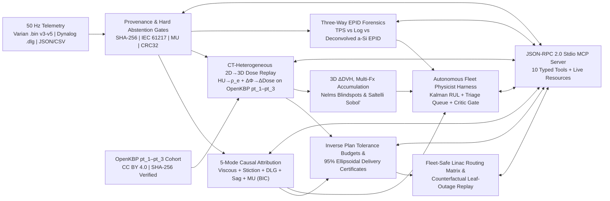
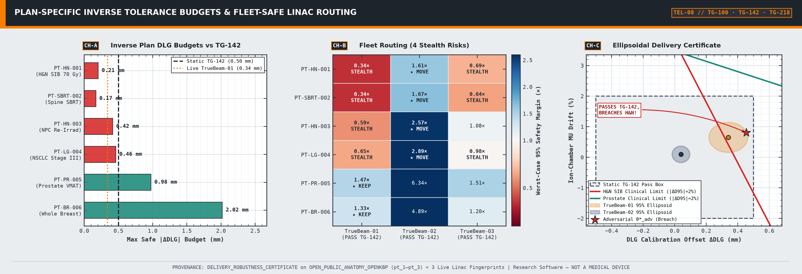
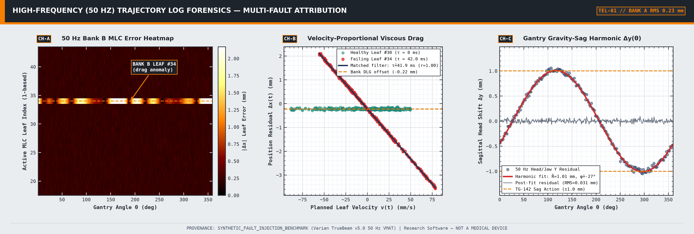
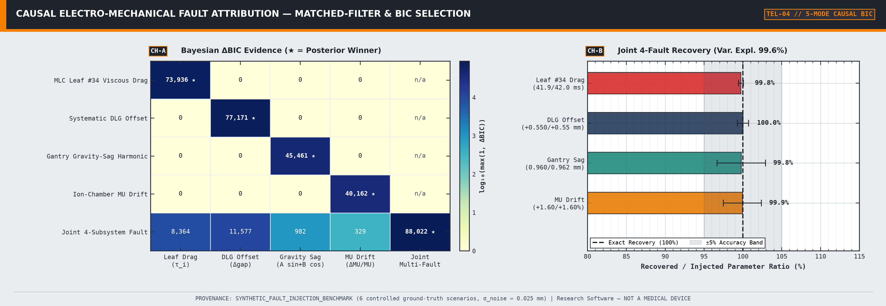
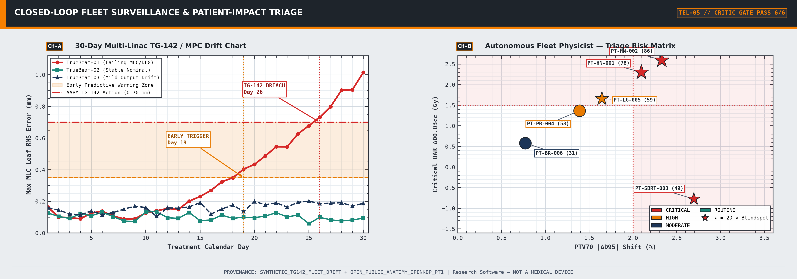

# linac-forensics

**Closed-Loop Linac Telemetry, Three-Way EPID, Perturbative 3D Delivery-Forensics & Plan-Specific Inverse Tolerance Robustness Engine**

[](https://www.python.org/)
[](pyproject.toml)
[](LICENSE)
[](LICENSE)
[](docs/AUDIT_REPORT.md)
[](docs/AUDIT_REPORT.md)
[](pyproject.toml)

> **Non-Commercial Research & Personal Use Only — Citation Required.**
> This software is licensed exclusively for **non-commercial academic/scientific research (with mandatory citation of `CITATION.cff`)** and **personal non-commercial study**. **Commercial use is strictly prohibited** without prior written authorization — see [LICENSE](LICENSE).
>
> **Research Software — NOT A MEDICAL DEVICE.**
> `linac-forensics` has **not** been cleared or approved by the FDA, EU MDR/CE, or any regulatory authority and must **never** be used for clinical patient QA sign-off, treatment decisions, or linear accelerator calibration.

---

## What Makes `linac-forensics` Unmatched — Even Against Paid Clinical QA Platforms

Commercial clinical QA suites (Mobius3D/FX, SunCHECK/PerFRACTION, LinacView, myQA) enforce **static, one-size-fits-all AAPM TG-142 machine tolerances** decoupled from **reactive patient QA**. `linac-forensics` unifies **AAPM TG-100 (risk-based QA)**, **TG-142 (machine tolerances)**, and **TG-218 (patient-specific QA)** into one closed inverse-physics loop:

- **Plan-Specific Inverse Mechanical Tolerance Budgeting & Adversarial Delivery Robustness Certificates (v0.3.0)**:
  - Inverts the heterogeneity-aware 3D perturbative dose Jacobian on real patient CT anatomy (**OpenKBP `pt_1–pt_3`**) to compute each plan's exact **maximum safe mechanical tolerances** (`|ΔDLG|`, `τ_MLC`, `β_stiction`, `R_sag`, `|ΔMU|`) — proving why high-modulation H&N SIB (`|ΔDLG| ≤ 0.21 mm`) and Spine SBRT (`≤ 0.17 mm`) breach clinical limits on linacs **still passing static TG-142** (`0.50 mm`).
  - Solves the exact **95% Bonferroni-ellipsoidal worst-case optimization** over each linac's live telemetry uncertainty ellipsoid to flag **TG-142 Stealth Risks** and emit a **Fleet-Wide Linac-to-Patient Safe-Routing Matrix** (rerouting complex plans to calibrated linacs while keeping open-field Prostate/Breast safely on drifting machines) + **Counterfactual Leaf-Outage 3D Replays**.
- **Three-Way Closed-Loop EPID Portal Dosimetry Forensics (`Planned TPS` vs. `Trajectory Log` vs. `Deconvolved a-Si EPID`)**: catches **encoder-blind silent hardware faults** (slipped optical encoders, unrecorded DLG/jaw drift, TG-142 beam-steering symmetry tilts) invisible to trajectory logs alone.
- **5-Mode Electro-Mechanical Causal Attribution (Matched-Filter + Bayesian BIC)**: separates **viscous motor drag** ($-\tau v$), **nonlinear Coulomb/Stribeck stiction & leadscrew backlash** ($-\beta \tanh(v/v_0)$), **DLG calibration offset**, **gantry gravity-sag harmonics**, and **ion-chamber MU drift** with 95% CIs.
- **Native Varian TrueBeam `.bin` (v3.0/v4.0/v5.0) + Legacy Dynalog `.dlg` + JSON/CSV** with 5 hard **`AbstentionError`** gates, **CT HU→$\rho_e$ heterogeneity-aware 3D replay** (preserving exact zero-error identity), **Kalman State-Space RUL Forecasting**, **Multi-Fraction Cumulative 3D Accumulation**, **Exact Saltelli–Jansen QMC Sobol' Sensitivity**, and a **10-Tool + Live-Resource JSON-RPC 2.0 MCP Server**.

---

## System Architecture



---

## Verified Benchmark Dashboard (v0.3.0)

All metrics are deterministically reproduced by `scripts/run_benchmarks.py` ([benchmark_summary.json](results/benchmark_summary.json)) on real **OpenKBP `pt_1`, `pt_2`, `pt_3`** anatomies paired with provenance-tagged synthetic fault benchmarks:

| Benchmark & Physics Invariant | Measured Result | Reference / Gate |
| --- | --- | --- |
| **Inverse Plan DLG Budgets vs Static TG-142 (`0.50 mm`)** | Spine SBRT **`0.17 mm`**, H&N SIB **`0.21 mm`** (tighter); Prostate **`0.98 mm`**, Breast **`2.02 mm`** | AAPM TG-100 / TG-142 |
| **Fleet-Safe Routing & TG-142 Stealth Risk Detection** | **4 Stealth Risks** on `TrueBeam-01` (all 3 linacs `PASSING_TG142`); transfers yield **`4.4×–4.9×` safety gain** | 95% Ellipsoidal Cert |
| **Counterfactual Leaf-Outage 3D Replay (Bank B #34)** | `PARKED_CLOSED`: `PTV ΔD95 = -56.5%` (`HOLD`) vs `ADJACENT_AVG`: `+0.00%` (`SAFE`) | OpenKBP `pt_1` 3D |
| **Three-Way EPID Encoder-Blind Silent Fault Detection** | Plan-vs-Log `γ = 100.0%` (blind) → Log-vs-EPID **`γ = 55.4%`** (`max\|ΔΦ\| = 15.2%`) | Caught & classified |
| **5-Mode Causal BIC Attribution (incl. Coulomb Stiction)** | Exact classification; Stiction `0.7015 / 0.70 mm`; Joint 4-fault **`99.8%–100.0%`** | 95% CIs cover truth |
| **Zero-Error Identity Invariant (w/ CT HU→$\rho_e$)** | `max\|ΔΦ\| = 0.0`, `max\|ΔD\| = 0.0 Gy`, 2D/3D `γ = 100.0%` | Exact machine epsilon |
| **Nelms 2D Gamma Blindspot Sweep (32 faulted cases)** | **17/17 (100%)** failing plans passed 2D `3%/2mm` (`≥95%`); **17/17 caught** by 3D `2%/1mm` & `ΔDVH` | AAPM TG-218 / Nelms |
| **Kalman State-Space RUL Forecast (Cutoff Day 20)** | Predicted breach in **`6.8 d`** (Day 26.8 vs actual **Day 26**; `72%` 10d breach prob) | `0.8 d` ahead error |
| **Varian `.bin` v5.0 Round-Trip (360 × 120 leaves, CRC32)** | Write `2.7 ms`, Parse `3.7 ms`, Max error `5.72 × 10⁻⁶ mm` | IEEE-754 `float32` |

---

## Publication-Grade Figures (8 × 300-DPI PNG + PDF, Visually Audited)

### 8. Plan-Specific Inverse Tolerance Budgets, Fleet-Safe Linac Routing & Adversarial Ellipsoid (v0.3 Flagship)


### 7. Three-Way EPID Silent Faults, Nonlinear Coulomb Stiction & Kalman RUL Forecasting


### 1. High-Frequency (50 Hz) Trajectory Log Forensics


### 2. Heterogeneity-Aware Perturbative Fluence-to-3D-Dose Replay on OpenKBP `pt_1`


### 3. Nelms et al. (2011) 2D Gamma Blindspot vs True 3D `ΔDVH`


### 4. Bayesian BIC Causal Fault Attribution & Joint 4-Fault Recovery


### 5. 30-Day Multi-Linac TG-142/MPC Drift & Clinical Patient Triage Matrix


### 6. Global Saltelli–Jansen QMC Sobol' Sensitivity (`S₁` vs `S_T`)


---

## Quickstart

```bash
# 1. Install dependencies with uv (Python 3.12)
uv sync --python 3.12 --extra dev

# 2. Verify / fetch OpenKBP pt_1, pt_2, pt_3 anatomies (CC BY 4.0, SHA-256 verified)
uv run python scripts/fetch_openkbp_anatomy.py

# 3. Run full test suite (44 tests, 0 warnings, >= 75% coverage gate) & lint
uv run pytest --cov=linac_forensics --cov-report=term-missing
uv run ruff check src tests scripts

# 4. Reproduce all benchmarks and 8 publication-grade figures (300-DPI PNG + PDF)
uv run python scripts/run_benchmarks.py
uv run python scripts/generate_figures.py
```

---

<details>
<summary><strong>Python API Workflow (Inverse Tolerance Budget → Adversarial Delivery Certificate → Fleet-Safe Routing & Leaf Outage)</strong></summary>

```python
from pathlib import Path
from linac_forensics import (
    compute_fleet_routing_matrix,
    load_openkbp_cohort,
    simulate_counterfactual_leaf_outage,
)

# 1. Load real SHA-256 verified OpenKBP cohort (pt_1, pt_2, pt_3)
cohort = load_openkbp_cohort(Path("data/openkbp"), verify_manifest=True)

# 2. Compute inverse plan budgets, 95% adversarial delivery certificates & safe linac transfers
routing = compute_fleet_routing_matrix(cohort)
print(f"TG-142 Stealth Risks detected across passing linacs: {routing.n_stealth_tg142_risks}")
for rec in routing.routing_recommendations:
    print(f"  {rec.patient_id:12s} | {rec.rationale}")

# 3. Counterfactual leaf-outage 3D ΔDVH replay (Bank B Leaf #34 immobilized)
parked = simulate_counterfactual_leaf_outage(cohort["pt_1"], outage_leaf_index=34, compensation_mode="PARKED_CLOSED")
adj = simulate_counterfactual_leaf_outage(cohort["pt_1"], outage_leaf_index=34, compensation_mode="ADJACENT_LEAF_AVERAGE")
print("PARKED_CLOSED:", parked.verdict, f"PTV ΔD95={parked.ptv_delta_d95_pct:+.2f}%")
print("ADJACENT_AVG :", adj.verdict, f"PTV ΔD95={adj.ptv_delta_d95_pct:+.2f}%")
```

</details>

<details>
<summary><strong>MCP Server (JSON-RPC 2.0 Stdio) — 10 Provenance-Gated Tools & Live Resources</strong></summary>

Launch the MCP server via:

```bash
uv run linac-forensics-mcp
```

**Exposed Tools (`tools/list`)**:
1. `linac_parse_trajectory_log` — Parse & validate `.bin` (v3.0/v4.0/v5.0), `.json`, or `.csv` logs with hard abstention gates.
2. `linac_compute_perturbative_dvh` — CT-heterogeneity-aware 2D fluence → 3D perturbative dose replay (`ΔD95`, `ΔD0.03cc`, `ΔgEUD`, `ΔTCP/NTCP`, 2D/3D Gamma).
3. `linac_diagnose_causal_fault` — 5-mode matched-filter & Bayesian BIC attribution (viscous drag, Coulomb stiction, DLG, gravity sag, MU drift).
4. `linac_compare_gamma_vs_dvh` — Sweep DLG/MLC faults and quantify Nelms et al. (2011) 2D gamma blindspots vs 3D `ΔDVH`.
5. `linac_triage_patient_fleet` — Multi-patient OpenKBP Autonomous Fleet Physicist harness + Kalman RUL + Critic-Verifier Gate.
6. `linac_run_sobol_sensitivity` — Exact Saltelli–Jansen QMC global Sobol' sensitivity (`S₁`, `S_T`, 95% CIs).
7. `linac_analyze_epid_three_way` — Three-way TPS vs. Trajectory-Log vs. Deconvolved EPID silent-fault forensics.
8. `linac_forecast_tg142_rul` — Local-linear-trend Kalman state-space RUL & breach-probability forecasting.
9. `linac_certify_plan_robustness` — Plan-specific inverse tolerance budgets, 95% ellipsoidal adversarial certificates & fleet-safe linac routing.
10. `linac_simulate_leaf_outage` — Counterfactual 3D `ΔDVH` leaf-outage replay (`PARKED_CLOSED` vs `ADJACENT_LEAF_AVERAGE`).

**Exposed Read-Only Resources (`resources/list`, `resources/read`)**:
- `linac://manifest/openkbp_pt1` · `linac://results/benchmark_summary` · `linac://results/incident_report` · `linac://docs/audit_report`

</details>

---

## License, Citation & Documentation

- **License**: [Non-Commercial Research & Personal Use License (`LICENSE`)](LICENSE) — free for academic/non-commercial research (citation required) and personal study; **commercial use strictly prohibited** without separate written authorization.
- **Citation**: If you use `linac-forensics` in any paper, preprint, thesis, or benchmark, you **must** cite it using [CITATION.cff](CITATION.cff).
- **Documentation**: [Engine Specification](docs/ENGINE_SPECIFICATION.md) · [Independent Audit Report](docs/AUDIT_REPORT.md) · [Data Sources & BibTeX](DATA_SOURCES_AND_CITATIONS.md) · [OpenKBP Attribution](data/openkbp/ATTRIBUTION.md)

### Key Scientific References
- **AAPM TG-142**: Klein EE et al. *Med. Phys.* 2009;36(9):4197–4212. DOI: `10.1118/1.3190392`
- **AAPM TG-218**: Miften M et al. *Med. Phys.* 2018;45(4):e53–e83. DOI: `10.1002/mp.12810`
- **Planar Gamma Blindspot**: Nelms BE, Zhen H, Tomé WA. *Med. Phys.* 2011;38(2):1037–1044. DOI: `10.1118/1.3544657`
- **OpenKBP Dataset (CC BY 4.0)**: Babier A et al. *Med. Phys.* 2021;48(9):5549–5561. DOI: `10.1002/mp.14845`
- **Global Sobol' Sensitivity**: Saltelli A et al. *Comput. Phys. Commun.* 2010;181(2):259–270. DOI: `10.1016/j.cpc.2009.09.018`
