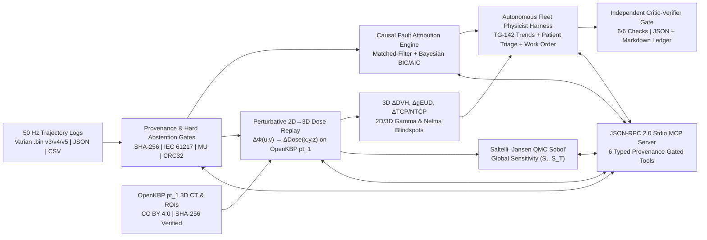
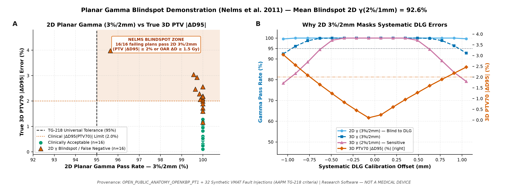
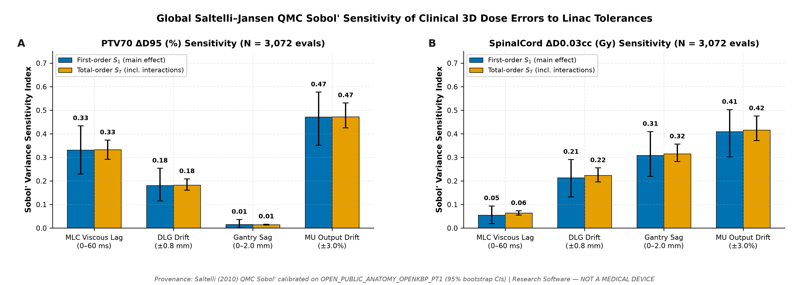

# linac-forensics

**Closed-Loop Linac Telemetry, EPID & Perturbative 3D Delivery-Forensics Engine with Frontier Agent Harness & MCP Server**

[](https://www.python.org/)
[](LICENSE)
[](LICENSE)
[](docs/AUDIT_REPORT.md)
[](docs/AUDIT_REPORT.md)
[](pyproject.toml)

> **Research Software — NOT A MEDICAL DEVICE.**
> `linac-forensics` is open-source scientific research software for radiotherapy machine physics, AAPM TG-142 / TG-218 QA methodology research, and delivery-forensics benchmarking. It has **not** been cleared or approved by the FDA, EU MDR/CE, or any regulatory authority and must **never** be used for clinical patient QA sign-off, treatment decisions, or linear accelerator calibration.

---

## Why `linac-forensics`?

Consumer AI chat interfaces cannot parse 50 Hz binary Varian TrueBeam trajectory logs (`.bin`), project sub-millimeter MLC aperture errors into 3D patient CT/OAR anatomy, or perform Bayesian causal attribution across coupled electro-mechanical linac subsystems. `linac-forensics` closes the loop between **high-frequency machine telemetry**, **3D anatomy-aware perturbative dosimetry**, **causal hardware fault isolation**, and an **auditable MCP / Agent Harness**:

- **Native Varian TrueBeam `.bin` Parser & Writer (v3.0 / v4.0 / v5.0)** + vendor-neutral JSON/CSV ingestion with hard **`AbstentionError`** integrity gates (`TIMESTAMP_DESYNC`, `MU_CONSERVATION_VIOLATION`, `UNMAPPED_IEC61217_COORDINATES`, `CORRUPTED_BINARY_LOG`, `INTERLOCK_INCOMPLETE_DELIVERY`).
- **Fast Perturbative Fluence-to-3D-Dose Replay (`ΔΦ → ΔDose → ΔDVH / ΔgEUD / ΔTCP / ΔNTCP`)** on real open-access **OpenKBP `pt_1` (CC BY 4.0)** 3D head-and-neck anatomy — exposing **Nelms et al. (2011) 2D 3%/2mm Gamma blindspots** while preserving an exact zero-error identity invariant (`actual == expected ⇒ ΔΦ ≡ 0, ΔDose ≡ 0, γ ≡ 100.0%`).
- **Physics-Informed Electro-Mechanical Causal Attribution (Matched-Filter + Bayesian BIC)** separating:
  1. Localized MLC leaf motor viscous drag / T-nut friction ($\Delta x_i(t) \approx -\tau_i v_i(t)$)
  2. Systematic Bank / Dosimetric Leaf Gap (DLG) calibration offset ($\Delta\text{gap} = c$)
  3. Gantry gravity-sag harmonic ($\Delta y(\theta) = A\sin\theta + B\cos\theta$)
  4. Monitor ion-chamber / dose-rate calibration drift ($\Delta\text{MU}/\text{MU} = \delta$)
- **Exact Saltelli–Jansen QMC Global Sobol' Sensitivity** quantifying main (`S₁`) and total-effect (`S_T`) variance drivers of `PTV70 ΔD95` and `SpinalCord ΔD0.03cc`.
- **Autonomous Fleet Physicist & Incident-Triage Harness + JSON-RPC 2.0 MCP Server** with an independent 6-check **Critic-Verifier Gate** emitting signed Markdown + JSON forensic ledgers.

---

## System Architecture



---

## Verified Benchmark Dashboard

All metrics below are deterministically reproduced by `scripts/run_benchmarks.py` (`results/benchmark_summary.json`) on real **OpenKBP `pt_1`** 3D anatomy paired with controlled synthetic fault-injection telemetry (explicitly tagged in `ProvenanceRecord`):

| Benchmark & Physics Invariant | Measured Result | Reference / Gate |
| --- | --- | --- |
| **Varian `.bin` v5.0 Round-Trip (360 × 120 leaves, CRC32)** | Write `1.72 ms`, Parse `3.57 ms`, Max error `5.72 × 10⁻⁶ mm` | IEEE-754 `float32` exact |
| **Zero-Error Identity Invariant (`actual == expected`)** | `max\|ΔΦ\| = 0.0`, `max\|ΔD\| = 0.0 Gy`, `γ = 100.0%` | Exact machine epsilon |
| **Single- & Joint 4-Fault BIC Attribution (6 scenarios)** | **6/6 exact classification**, `99.8%–100.0%` joint recovery (`99.6%` var. explained) | 95% CIs cover all ground truths |
| **Nelms 2D Gamma Blindspot Sweep (32 faulted deliveries)** | **16/16 (100%)** failing plans passed 2D `3%/2mm` (`≥95%`); **16/16 caught** by 3D `2%/1mm` & `ΔDVH` | AAPM TG-218 / Nelms 2011 |
| **30-Day Fleet TG-142 Drift & 6-Patient Triage Harness** | Early trigger **Day 19** (7 days before **Day 26** breach); Critic Gate **6/6 PASSED** | AAPM TG-142 |
| **Global Sobol' Sensitivity (`N = 3,072` evals/metric)** | `PTV70 ΔD95`: MU (`0.47`), MLC Lag (`0.33`), DLG (`0.18`) · `SpinalCord ΔD0.03cc`: MU (`0.41`), Sag (`0.31`), DLG (`0.21`) | Saltelli 2010 QMC |

---

## Publication-Grade Figures (300-DPI PNG + PDF, Visually Audited)

### 1. High-Frequency (50 Hz) Trajectory Log Forensics


### 2. Fast Perturbative Fluence-to-3D-Dose Replay on OpenKBP `pt_1`


### 3. Nelms et al. (2011) 2D Gamma Blindspot vs True 3D `ΔDVH`


### 4. Bayesian BIC Causal Fault Attribution & Joint 4-Fault Recovery


### 5. 30-Day Multi-Linac TG-142/MPC Drift & Clinical Patient Triage Matrix


### 6. Global Saltelli–Jansen QMC Sobol' Sensitivity (`S₁` vs `S_T`)


---

## Quickstart

```bash
# 1. Install dependencies with uv (Python 3.12)
uv sync --python 3.12 --extra dev

# 2. Verify / fetch OpenKBP pt_1 anatomy (CC BY 4.0, SHA-256 verified)
uv run python scripts/fetch_openkbp_anatomy.py

# 3. Run full test suite (30 tests, 0 warnings, >= 75% coverage gate) & lint
uv run pytest --cov=linac_forensics --cov-report=term-missing
uv run ruff check src tests scripts

# 4. Reproduce all benchmarks and 6 publication-grade figures (300-DPI PNG + PDF)
uv run python scripts/run_benchmarks.py
uv run python scripts/generate_figures.py
```

---

<details>
<summary><strong>Python API Workflow (Binary Log Parse → Causal Attribution → 3D Perturbative DVH)</strong></summary>

```python
from pathlib import Path
from linac_forensics import (
    compute_perturbative_dose_replay,
    diagnose_causal_faults,
    generate_synthetic_vmat_log,
    load_openkbp_patient,
    parse_varian_trajectory_bin,
    write_varian_trajectory_bin,
)

# 1. Create and round-trip a Varian TrueBeam v5.0 binary trajectory log (.bin)
log = generate_synthetic_vmat_log(
    log_id="TB01_ARC1",
    failing_bank="B",
    failing_leaf_index=34,
    leaf_drag_ms=42.0,
    dlg_offset_mm=0.55,
    gantry_sag_sin_mm=0.85,
    mu_drift_pct=1.6,
    noise_sigma_mm=0.025,
)
bin_path = write_varian_trajectory_bin(log, Path("results/demo_v5.bin"), header_version="5.0")
parsed = parse_varian_trajectory_bin(bin_path)

# 2. Causal electro-mechanical fault attribution (matched-filter + Bayesian BIC)
diag = diagnose_causal_faults(parsed)
print(diag.primary_root_cause, diag.active_faults, diag.service_recommendation)

# 3. Fast perturbative 3D dose replay on real OpenKBP pt_1 anatomy (CC BY 4.0)
anatomy = load_openkbp_patient(Path("data/openkbp/pt_1"), verify_manifest=True)
impact = compute_perturbative_dose_replay(parsed, anatomy)
print(
    f"2D γ(3%/2mm)={impact.gamma_2d_3pct_2mm_pass_pct:.1f}% | "
    f"3D γ(2%/1mm)={impact.gamma_3d_2pct_1mm_pass_pct:.1f}% | "
    f"Blindspot={impact.gamma_blindspot_detected}"
)
```

</details>

<details>
<summary><strong>MCP Server (JSON-RPC 2.0 Stdio) — 6 Provenance-Gated Tools</strong></summary>

Launch the MCP server directly via the installed console entrypoint:

```bash
uv run linac-forensics-mcp
```

Exposed tools (`tools/list`):
1. `linac_parse_trajectory_log` — Parse & validate `.bin` (v3.0/v4.0/v5.0), `.json`, or `.csv` logs with hard abstention gates.
2. `linac_compute_perturbative_dvh` — 2D fluence → 3D perturbative dose replay (`ΔD95`, `ΔD0.03cc`, `ΔgEUD`, `ΔTCP/NTCP`, 2D/3D Gamma).
3. `linac_diagnose_causal_fault` — Matched-filter & Bayesian BIC separation of MLC drag, DLG offset, gravity sag, and MU drift.
4. `linac_compare_gamma_vs_dvh` — Sweep DLG/MLC faults and quantify Nelms et al. (2011) 2D gamma blindspots vs 3D `ΔDVH`.
5. `linac_triage_patient_fleet` — Full Autonomous Fleet Physicist harness + Critic-Verifier Gate + Service Work Order.
6. `linac_run_sobol_sensitivity` — Exact Saltelli–Jansen QMC global Sobol' sensitivity (`S₁`, `S_T`, 95% CIs).

Example JSON-RPC 2.0 invocation over stdio:

```bash
printf '%s\n' \
  '{"jsonrpc":"2.0","id":1,"method":"initialize"}' \
  '{"jsonrpc":"2.0","id":2,"method":"tools/call","params":{"name":"linac_diagnose_causal_fault","arguments":{"synthetic_faults":{"failing_bank":"B","failing_leaf_index":34,"leaf_drag_ms":42.0,"dlg_offset_mm":0.5}}}}' \
  | uv run linac-forensics-mcp
```

</details>

---

## Documentation, Provenance & Citations

- [Engine Specification (`docs/ENGINE_SPECIFICATION.md`)](docs/ENGINE_SPECIFICATION.md)
- [Independent Audit Report (`docs/AUDIT_REPORT.md`)](docs/AUDIT_REPORT.md)
- [Data Sources, Licenses & BibTeX (`DATA_SOURCES_AND_CITATIONS.md`)](DATA_SOURCES_AND_CITATIONS.md)
- [OpenKBP `pt_1` Attribution (`data/openkbp/ATTRIBUTION.md`)](data/openkbp/ATTRIBUTION.md) & [SHA-256 Manifest (`data/openkbp/pt_1/MANIFEST.json`)](data/openkbp/pt_1/MANIFEST.json)
- [Citation Metadata (`CITATION.cff`)](CITATION.cff)

### Key Scientific References
- **AAPM TG-142**: Klein EE et al. *Med. Phys.* 2009;36(9):4197–4212. DOI: `10.1118/1.3190392`
- **AAPM TG-218**: Miften M et al. *Med. Phys.* 2018;45(4):e53–e83. DOI: `10.1002/mp.12810`
- **Planar Gamma Blindspot**: Nelms BE, Zhen H, Tomé WA. *Med. Phys.* 2011;38(2):1037–1044. DOI: `10.1118/1.3544657`
- **OpenKBP Dataset (CC BY 4.0)**: Babier A et al. *Med. Phys.* 2021;48(9):5549–5561. DOI: `10.1002/mp.14845`
- **Global Sobol' Sensitivity**: Saltelli A et al. *Comput. Phys. Commun.* 2010;181(2):259–270. DOI: `10.1016/j.cpc.2009.09.018`
